

  <a href="https://toskaman.github.io/">
    <picture>
      <source media="(prefers-color-scheme: dark)" srcset="assets/hero-dark.svg" />
      <source media="(prefers-color-scheme: light)" srcset="assets/hero-light.svg" />
      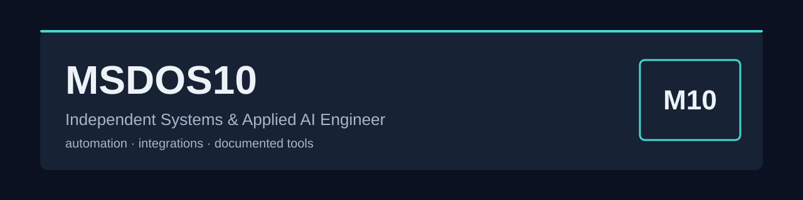
    </picture>
  </a>

  <a href="https://toskaman.github.io/"><strong>Portfolio ↗</strong></a>
  &nbsp;&nbsp;·&nbsp;&nbsp;
  <a href="#selected-work">Selected Work</a>
  &nbsp;&nbsp;·&nbsp;&nbsp;
  <a href="#systems--tooling">Systems &amp; Tooling</a>
  &nbsp;&nbsp;·&nbsp;&nbsp;
  <a href="#range--practice">Range &amp; Practice</a>
  &nbsp;&nbsp;·&nbsp;&nbsp;
  <a href="#contact">Contact</a>

 

<picture>
  <source media="(prefers-color-scheme: dark)" srcset="assets/div-work-dark.svg" />
  <source media="(prefers-color-scheme: light)" srcset="assets/div-work-light.svg" />
  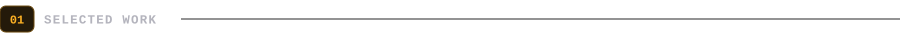
</picture>

  <a href="https://github.com/toskaman/openbridge"><picture><source media="(prefers-color-scheme: dark)" srcset="assets/card-openbridge-dark.svg" /><source media="(prefers-color-scheme: light)" srcset="assets/card-openbridge-light.svg" />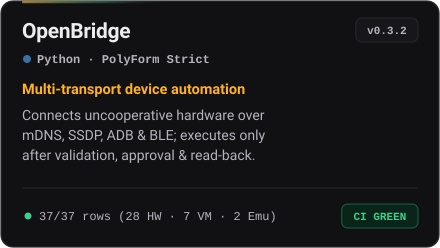</picture></a>
  <a href="https://github.com/toskaman/genesis-rt"><picture><source media="(prefers-color-scheme: dark)" srcset="assets/card-genesis-dark.svg" /><source media="(prefers-color-scheme: light)" srcset="assets/card-genesis-light.svg" /></picture></a>
   
  <a href="https://github.com/toskaman/anticipate-codegeist-2026"><picture><source media="(prefers-color-scheme: dark)" srcset="assets/card-anticipate-dark.svg" /><source media="(prefers-color-scheme: light)" srcset="assets/card-anticipate-light.svg" />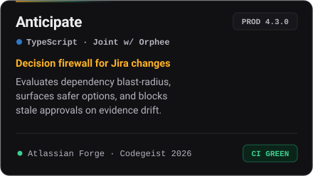</picture></a>
  <a href="https://github.com/toskaman/OpenKF"><picture><source media="(prefers-color-scheme: dark)" srcset="assets/card-openkf-dark.svg" /><source media="(prefers-color-scheme: light)" srcset="assets/card-openkf-light.svg" />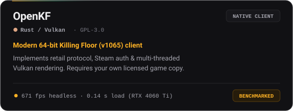</picture></a>

  
    <strong>OpenBridge:</strong> <a href="https://github.com/toskaman/openbridge/blob/main/docs/DEVICE_EVIDENCE.json">Evidence</a> · <a href="https://youtu.be/TZaxCcRmrLQ">Demo</a>
    &nbsp;|&nbsp;
    <strong>GENESIS RT:</strong> <a href="https://github.com/toskaman/genesis-rt/blob/main/docs/CLAIMS.md">Claims</a>
    &nbsp;|&nbsp;
    <strong>Anticipate:</strong> <a href="https://github.com/toskaman/anticipate-codegeist-2026/blob/main/docs/evidence/EVIDENCE_PACK.md">Evidence Pack</a>
    &nbsp;|&nbsp;
    <strong>OpenKF:</strong> <a href="https://github.com/toskaman/OpenKF/blob/main/docs/BENCHMARKS.md">Benchmarks &amp; Limits</a>
  

 

<picture>
  <source media="(prefers-color-scheme: dark)" srcset="assets/div-more-dark.svg" />
  <source media="(prefers-color-scheme: light)" srcset="assets/div-more-light.svg" />
  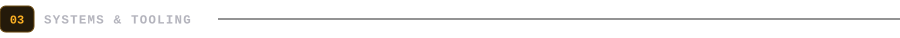
</picture>

  <a href="https://github.com/toskaman/orpane-proof-package"><picture><source media="(prefers-color-scheme: dark)" srcset="assets/mini-orpane-dark.svg" /><source media="(prefers-color-scheme: light)" srcset="assets/mini-orpane-light.svg" />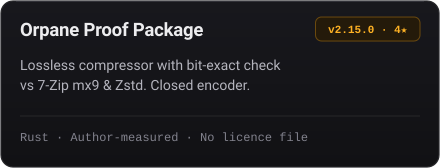</picture></a>
  <a href="https://github.com/toskaman/reversa"><picture><source media="(prefers-color-scheme: dark)" srcset="assets/mini-reversa-dark.svg" /><source media="(prefers-color-scheme: light)" srcset="assets/mini-reversa-light.svg" />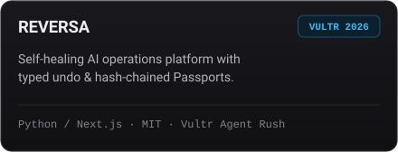</picture></a>
   
  <a href="https://github.com/toskaman/afterpact"><picture><source media="(prefers-color-scheme: dark)" srcset="assets/mini-afterpact-dark.svg" /><source media="(prefers-color-scheme: light)" srcset="assets/mini-afterpact-light.svg" />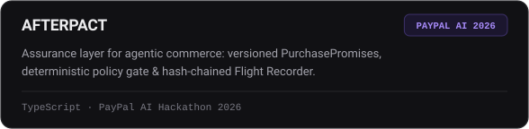</picture></a>
  <a href="https://github.com/toskaman/Freenekit"><picture><source media="(prefers-color-scheme: dark)" srcset="assets/mini-freenekit-dark.svg" /><source media="(prefers-color-scheme: light)" srcset="assets/mini-freenekit-light.svg" />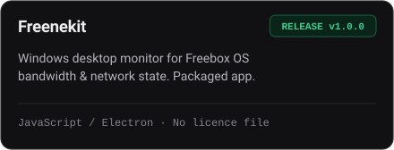</picture></a>

- **[PHOENIX](https://github.com/toskaman/UGREEN-PHOENIX)** — Recovery checks for a UGREEN AI NAS project using fixed evidence labels. Official static checker passed; real NAS hardware run not in repository yet.
- **[BridgeWindows v4](https://github.com/toskaman/BridgeWindows-v4)** — Multi-PC agent bridge with HMAC mutual authentication. Channel is authenticated and plaintext for trusted LANs; no GitHub release or licence file.
- **[RBX-Manager-2](https://github.com/toskaman/RBX-Manager-2)** — Multi-Roblox Windows manager (10 stars) with 320×240 micro-windows and memory optimization. No licence file.

 

<picture>
  <source media="(prefers-color-scheme: dark)" srcset="assets/div-range-dark.svg" />
  <source media="(prefers-color-scheme: light)" srcset="assets/div-range-light.svg" />
  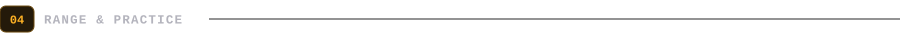
</picture>

  <picture>
    <source media="(prefers-color-scheme: dark)" srcset="assets/practice-dark.svg" />
    <source media="(prefers-color-scheme: light)" srcset="assets/practice-light.svg" />
    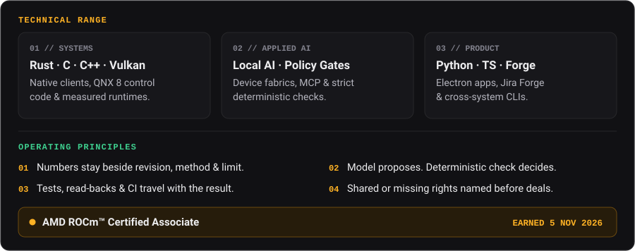
  </picture>

 

  <a href="mailto:toskaman5962+portfolio@gmail.com">
    <picture>
      <source media="(prefers-color-scheme: dark)" srcset="assets/footer-dark.svg" />
      <source media="(prefers-color-scheme: light)" srcset="assets/footer-light.svg" />
      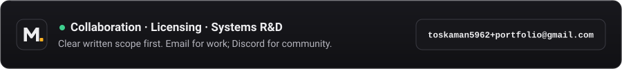
    </picture>
  </a>

  
  
  

Licensing &amp; rights disclosure

- **OpenBridge** — PolyForm Strict 1.0.0 on current main. That licence limits use.
- **Anticipate** — proprietary, shared 50/50 with Orphee. A deal needs both holders. Write to `info@lepcpro.fr`.
- **GENESIS RT** — Apache-2.0.
- **REVERSA** — MIT.
- **OpenKF** — GPL-3.0-or-later. The clean-room statement is the author's. Any acquisition needs an IP review, and the game itself is not mine to license.
- **Orpane, Freenekit, BridgeWindows, RBX-Manager-2** — no licence file. Evaluation only, in writing.

Nothing on this page is an offer to sell a right that is shared, missing, or someone else's.

