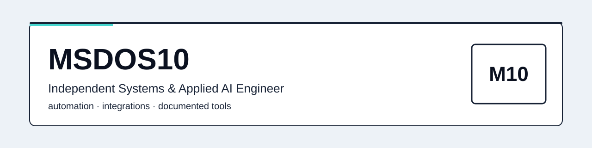

<picture>
  <source media="(prefers-color-scheme: dark)" srcset="assets/hero-dark.svg" />
  <source media="(prefers-color-scheme: light)" srcset="assets/hero-light.svg" />
  
</picture>

# Hi, I'm MSDOS10

**Independent Systems & Applied AI Engineer.** I design automation, integrations, and AI-assisted workflows that ship with documentation and honest evidence.

## What I Build

- **Automation systems** — scheduled jobs, pipelines, and unattended workflows with logs and recovery paths. See [OpenBridge](https://github.com/toskaman/openbridge).
- **Integrations** — APIs, bridges, and multi-machine tooling across Windows and Linux. See [BridgeWindows-v4](https://github.com/toskaman/BridgeWindows-v4) and [Freenekit](https://github.com/toskaman/Freenekit).
- **Applied-AI decision support** — evidence graphs and review gates inside real team tools. See [Anticipate](https://github.com/toskaman/anticipate-codegeist-2026) (joint work, see notes).
- **Performance and interop engineering** — measured native clients and verification suites. See [OpenKF](https://github.com/toskaman/OpenKF) and [orpane-proof-package](https://github.com/toskaman/orpane-proof-package).

## Featured Work

### 1. OpenBridge — flagship automation and integration fabric

- Repo: [toskaman/openbridge](https://github.com/toskaman/openbridge) · Docs: [release status](https://raw.githubusercontent.com/toskaman/openbridge/main/docs/RELEASE_STATUS.md) · [jury start](https://raw.githubusercontent.com/toskaman/openbridge/main/docs/jury/JURY_START_HERE.md)
- Dependency-free Python runtime; verification via stdlib `unittest discover` on Windows, Ubuntu, and macOS plus Playwright browser smokes ([workflow](https://raw.githubusercontent.com/toskaman/openbridge/main/.github/workflows/verify.yml)).
- Reported suite: 2115 tests green at `origin/main 2351308` (2 Nov 2026, PRs 164–177). Re-verify at current head before citing as current.
- Device evidence: 37 first-party records (28 real-hardware + 7 full-guest + 2 official emulators) — records, not 37 unique physical capabilities. Simulations and replays are labeled and never counted as physical proof.
- License: PolyForm Strict 1.0.0 on main (use-only; no distribution, modification, derivatives, or sublicense). MIT rights attach only to the `v0.2.0`-tagged snapshot.
- Built as a Meta Global AI Developer Hackathon 2026 entry (Indie Developer). No placement claimed.

### 2. Anticipate — Decision Firewall for Jira (joint work with Orphee, 50/50)

- Repo: [toskaman/anticipate-codegeist-2026](https://github.com/toskaman/anticipate-codegeist-2026) · Manifest: [manifest.yml](https://raw.githubusercontent.com/toskaman/anticipate-codegeist-2026/main/manifest.yml)
- Forge app: full-page Custom UI, `jira:workflowValidator`, Rovo agent with 5 actions, Rovo MCP with 5 tools (graph, retirement/upgrade simulation, passport, plan freshness).
- Hosted runs on a dev site are maintainer-reported (small test dataset; 6/6 writes verified; drift refusal with 0 writes). No third-party attestation.
- Screenshots in the repo are mock-transport UI captures, not hosted-Jira proof; video claims cover only what a real install shows.
- Simulation benchmark: exact-vs-oracle on 200 local synthetic graphs (deterministic seeds, 2 Nov 2026). Not a real-world prediction claim.
- CI green on main `5e45ed5` (PR #33); frontend job builds only. Test counts per STATUS.md (backend 72, simulation 11, contracts 3, frontend 60 unit) are maintainer-reported.
- License: proprietary, source-available, explicitly not open source. Joint ownership: any license, sale, or transfer needs written agreement of both holders.

### 3. OpenKF — native 64-bit game client engineering (GPL-3.0-or-later)

- Repo: [toskaman/OpenKF](https://github.com/toskaman/OpenKF) · Method: [BENCHMARKS.md](https://raw.githubusercontent.com/toskaman/OpenKF/main/docs/BENCHMARKS.md) · [bench.ps1](https://raw.githubusercontent.com/toskaman/OpenKF/main/scripts/bench.ps1)
- Headline numbers are method-documented with adjacent caveats: 671 FPS solo headless offscreen orbit (1280x720, RTX 4060 Ti, Win11, v1.9.0 night run, p95 1.69ms) shown next to 95–99 FPS live at ~155 actors. Never compare headless-no-present 671 with presented frames.
- Map load 0.14s vs retail marker (~24x) is a marker-to-marker comparison, documented in the bench notes.
- PresentMon 2.6.0 windowed comparison: live wave combat vs retail solo empty map, heavier OpenKF scene disclosed.
- Raw bench JSON/CSV outputs are gitignored, so numbers are method-documented but not independently reproducible from public artifacts. Headline table is v1.9.0 data under a v1.10.0 header with a disclosed pending re-run.
- No GitHub releases or tags exist; `v1.x` labels are documentary. Author describes a clean-room approach reusing no retail binaries (author assertion; requires IP review before any acquisition).

### 4. Orpane proof package — lossless-compression verification suite

- Repo: [toskaman/orpane-proof-package](https://github.com/toskaman/orpane-proof-package) · Log: [LOG.md](https://raw.githubusercontent.com/toskaman/orpane-proof-package/main/LOG.md) · Report: [BENCHMARK_REPORT.md](https://raw.githubusercontent.com/toskaman/orpane-proof-package/main/BENCHMARK_REPORT.md)
- Verified: bit-exact round-trip for the 2 shipped files (Canterbury `alice29.txt`, Calgary `pic`); 7-Zip 26.02 control sizes match the log tables.
- Scope limit: only 2 raw files ship; the 60-stream aggregate and any Silesia-wide win-rate claims are not verifiable from public artifacts and are not claimed here.
- Known inconsistencies are disclosed in-repo: shipped `.orpane` sizes vs log tables, Zstd flag text (`-22` vs `-19`), decoder binary size vs claimed bytes, version strings. Exact 7-Zip CLI is not recorded, so byte-identical replication is not possible.
- Decoder is open (Rust; entropy stage dispatches to brotli, bzip2-rs, ruzstd, lzma-rs; custom OLZ1/OLZ2 + CM paths). Encoder is closed, so pipeline superiority claims stay unverified.

## Engineering Evidence (numbers with limits)

- OpenBridge: 2115 green at `origin/main 2351308` — [RELEASE_STATUS.md](https://raw.githubusercontent.com/toskaman/openbridge/main/docs/RELEASE_STATUS.md). Limit: rev-pinned; re-verify at head `a5e8208`.
- OpenBridge: 37 first-party evidence records (28 + 7 + 2) — [README](https://raw.githubusercontent.com/toskaman/openbridge/main/README.md). Limit: first-party records; one row notes no committed transcript.
- OpenBridge CI: latest inspected run `41524974983` (2 Nov 2026) succeeded on branch `release/absolute-final`, not main head — [Actions](https://api.github.com/repos/toskaman/openbridge/actions/runs?per_page=3).
- Anticipate CI: green on main `5e45ed5` (PR #33) — [Actions](https://api.github.com/repos/toskaman/anticipate-codegeist-2026/actions/runs?per_page=5). Limit: frontend builds only.
- OpenKF: 671 solo headless / 95–99 live / 0.14s load / PresentMon 236-vs-120 — [BENCHMARKS.md](https://raw.githubusercontent.com/toskaman/OpenKF/main/docs/BENCHMARKS.md). Limits: gitignored raw outputs; CPU model/cores undisclosed; v1.9.0 data under v1.10.0 header.
- Orpane: 2-file bit-exact round-trip — [tree](https://api.github.com/repos/toskaman/orpane-proof-package/git/trees/main?recursive=1). Limit: 2 files only.
- Freenekit v1.0.0: 112,501,277-byte asset (28 Jul 2026) scanned clean on release day by Jotti 0/13, byte-exact — [releases](https://api.github.com/repos/toskaman/Freenekit/releases) and [Jotti](https://virusscan.jotti.org/en-US/filescanjob/b9imgyg8w6). Limit: version-pinned hygiene, not ongoing certification.
- RBX Manager 2: 800x600 to 320x240 is 84% fewer pixels (arithmetic holds) — [showcase](https://toskaman.github.io/RBX-Manager-2/). Limit: VRAM-load extrapolation, Byfron/Hyperion safety, and VirusTotal 0/72 are author claims without vendor or linkable-report attestation.

How to read these numbers

Each figure links to the file or run it comes from. Revision-pinned means the number was true at that commit, not necessarily at head. Self-reported means maintainer-measured without third-party attestation. First-party records means the evidence log was written by the project owner. I keep the limits next to the numbers on purpose.

## Additional Projects

- **RBX Manager 2** — Windows multi-account manager with micro-windows, per-account FPS caps, and a cookie vault. Showcase: [site](https://toskaman.github.io/RBX-Manager-2/) · Repo: [toskaman/RBX-Manager-2](https://github.com/toskaman/RBX-Manager-2). Notes: no LICENSE file (all rights reserved by default); binaries distributed via Discord; public tag `v1.9.34.1` trails badge text; independent utility, not affiliated with Roblox Corporation.
- **BridgeWindows-v4** — master PC administers up to 8 Windows/Linux PCs over LAN via authenticated reverse-TCP agents; custom v4 mutual-HMAC wire protocol; 5-target C agent matrix with staged binaries and SHA256SUMS. Repo: [toskaman/BridgeWindows-v4](https://github.com/toskaman/BridgeWindows-v4). Notes: no releases/tags; E2E 23/23 and self-test are README-reported; ARM64 targets compile-only (no hardware on hand, honestly scoped); no LICENSE file.
- **Freenekit** — Electron + React Windows desktop app for Freebox OS monitoring (line rates, per-process bandwidth, LAN devices, Wi-Fi analysis, MAC-alarm, NAT presets, call logs, reboot, systray). Repo: [toskaman/Freenekit](https://github.com/toskaman/Freenekit) · Release: [v1.0.0](https://api.github.com/repos/toskaman/Freenekit/releases). Notes: full Freebox API pairing + HMAC-SHA1 sessions; model/API-compat list is maintainer-reported; no LICENSE file; donationware.

## How I Engineer

- Written specs before code; docs ship with the change.
- Tests and CI where they pay off; counts reported at pinned revisions.
- Method notes next to every benchmark; limits stay visible.
- Small, reviewable changes; honest scoping when hardware or access is missing.
- No fake badges, no invented metrics, no borrowed logos.

## About

I'm MSDOS10, an independent engineer working in English with buyers and collaborators internationally. I'm autistic; I work best with clear written requirements and async communication, and I put the same preference into my docs: explicit steps, stated limits, no guessing. Outside contracts I maintain the projects above and keep their evidence trails current.

## Commercial Opportunities

Open to licensing and strategic acquisition discussions, subject to rights and terms.

- OpenBridge: main-snapshot use-only (PolyForm Strict); MIT scope is the `v0.2.0` tag only. Model-derived artifact terms require legal/ownership review.
- Anticipate: joint 50/50 ownership; any deal needs both holders' written agreement. Licensing contact for the joint work: info@lepcpro.fr (requires legal/ownership review of entity).
- OpenKF: GPL-3.0-or-later; retail-interop posture is an author assertion and requires IP review.
- RBX Manager 2, BridgeWindows-v4, Freenekit: no LICENSE file (all rights reserved by default); terms to be agreed in writing. Requires legal/ownership review.
- No prices, revenue, clients, or valuations are stated anywhere on this profile. Serious enquiries start with a written description of the intended use.

## Contact

1. **Email (best for serious enquiries):** toskaman5962+portfolio@gmail.com — [write me](mailto:toskaman5962+portfolio@gmail.com?subject=Enquiry%20via%20GitHub%20profile)
2. **Discord (quick chat):** `therealcopper` via [invite](https://discord.gg/zNpj8ctH9p)
3. **Code and portfolio:** [github.com/toskaman](https://github.com/toskaman) · [portfolio](https://toskaman.github.io/msdos/)

