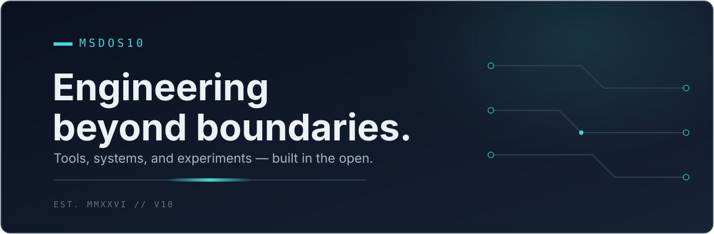

<picture>
  <source media="(prefers-color-scheme: dark)" srcset="assets/msdos10-hero-dark.svg" />
  <source media="(prefers-color-scheme: light)" srcset="assets/msdos10-hero-light.svg" />
  
</picture>

# Hi, I'm MSDOS10

**Independent Multidisciplinary Engineer & Technology Creator.** I build automation, integrations, and applied-AI workflows — with evidence and honest limits.

## What I Build

- **Automation & integrations** — device bridges, cross-system tooling, and workflows that ship (OpenBridge, BridgeWindows).
- **Applied AI decision support** — a Jira decision firewall on Atlassian Forge (Anticipate — joint 50/50 with Orphee). 
- **Native & performance work** — Rust clients and compression research with noted benchmarks (OpenKF, Orpane). 
- **Community tooling** — Roblox multi-account tooling and a Freebox companion app (RBX-Manager-2, Freenekit).

## Featured Work

### 1. OpenBridge — automation bridge with a pinned evidence trail

Cross-device automation with a documented test suite and device record set: **2,115 tests green** (2 Nov 2026 — see the linked release status for the pinned revision) and **37 device evidence rows, all VERIFIED** (28 real hardware, 7 full guest OS, 2 official platform emulators). CI green on main. Licence: PolyForm Strict 1.0.0 on current main (use-only); the historical v0.2.0 tag snapshot is MIT.

- [Repository](https://github.com/toskaman/openbridge) · [Release status](https://github.com/toskaman/openbridge/blob/main/docs/RELEASE_STATUS.md) · [Device evidence](https://github.com/toskaman/openbridge/blob/main/docs/DEVICE_EVIDENCE.json)

### 2. Anticipate — Jira decision firewall (Codegeist 2026 entry)

Atlassian Forge app that screens Jira changes before they land: risk scoring, drift refusal, and validator checks. Honest scope notes: UI screenshots are mock-transport captures (no live Forge captures published); hosted-run figures are self-reported without third-party attestation; Rovo answers are dev-site, admin-gated; the similarly-named share target is not configured (prototype adapter only). Test counts differ between docs (STATUS.md vs Devpost draft — unresolved, see Evidence). Joint 50/50 ownership with Orphee — any licence, sale, or transfer needs both holders' written agreement; licensing enquiries: info@lepcpro.fr.

- [Repository](https://github.com/toskaman/anticipate-codegeist-2026) · [Status](https://github.com/toskaman/anticipate-codegeist-2026/blob/main/docs/STATUS.md) · [Evidence pack](https://github.com/toskaman/anticipate-codegeist-2026/blob/main/docs/evidence/EVIDENCE_PACK.md)

### 3. OpenKF — native game-client interop (Rust)

Clean-room-asserted native client with documented headless benchmarks: 671 fps solo headless, 0.14 s load, PresentMon 236-vs-120 against the retail 120 cap — with same-GPU contamination and version-header caveats disclosed in the doc. Raw bench outputs are gitignored by design; CPU details live in the raw JSON. Requires the user's own licensed game copy v1065; no game content redistributed. Licence: GPL-3.0-or-later. No releases published yet.

- [Repository](https://github.com/toskaman/OpenKF) · [Benchmarks](https://github.com/toskaman/OpenKF/blob/main/docs/BENCHMARKS.md)

### 4. Orpane — compression proof package (Rust)

Bit-exact round-trip **verified for the 2 shipped files** (decompressed SHAs match originals); 7-Zip 26.02 control sizes match the log tables. Broader win-rate claims (60-stream / 53-stream sets) are self-reported — no raw data beyond the 2 files — and the docs carry flag, size, and version inconsistencies (see Evidence). Closed encoder, source-visible decoder. Unlicensed: all rights reserved, evaluation only under written terms.

- [Repository](https://github.com/toskaman/orpane-proof-package) · [Benchmark report](https://github.com/toskaman/orpane-proof-package/blob/main/BENCHMARK_REPORT.md)

## Engineering Evidence — numbers with limits

Every figure below names its source revision and limit. Self-reported means the author's measurement without independent attestation.

- **OpenBridge: 2,115 tests green** (2 Nov 2026; pinned revision in RELEASE_STATUS.md; unmerged branches claim higher counts — not cited here).
- **OpenBridge: 37/37 device rows VERIFIED** (28 + 7 + 2 split; caveats in-file: watch row has no transcript; several rows n=1 / oracle-only). Framed as records, not 37 unique physical capabilities.
- **OpenBridge: CI green on main** (2 Nov 2026; no award claimed — hackathon entry only, finals pending at time of writing).
- **Anticipate: test counts contradictory** — STATUS.md says 72 backend + 11 simulation + 3 contracts (+60 frontend) while the Devpost draft says 43 backend + 10 engine + 3 contract tests. CI core job runs backend + contracts + simulation; frontend job is build-only.
- **Anticipate: benchmark P=R=1.00** vs an independent brute-force oracle on 200 local synthetic graphs (2 Nov, owner PC, Node 24.22.1) — narrow scope, not a real-world ratio.
- **OpenKF: 671 fps solo headless / 0.14 s load / 236-vs-120 PresentMon** with disclosed caveats (retail 120 hard cap, same-GPU run, v1.9.0 data under v1.10.0 header, raw outputs gitignored).
- **Orpane: 2-file round-trip verified; wider claims self-reported** (shipped-vs-log size deltas, Zstd -22 vs -19, 7-vs-5 codec lists, decoder byte-size drift, benchmark input larger than shipped input — all disclosed in the evidence report).
- **Freenekit: Jotti 0/13 independent scan on release day** (v1.0.0 zip, 28 Jul 2026) — version-pinned, not ongoing certification. VirusTotal link hash matches the release MD5; verdict text unconfirmed.

Methods and revisions

- OpenBridge figures: main-branch README + RELEASE_STATUS.md + DEVICE_EVIDENCE.json (recounted row by row); CI status from the repo Actions page.
- Anticipate figures: STATUS.md, EVIDENCE_PACK.md, DEVPOST_DRAFT.md, UI_VISUAL_QA.md, ci.yml on main — contradictions preserved, not smoothed.
- OpenKF figures: docs/BENCHMARKS.md interim section + README Legal; .gitignore confirms /output/ excluded by design.
- Orpane figures: LOG.md + README + BENCHMARK_REPORT.md + file tree + decoder Cargo.toml; round-trip SHAs recomputed from the tree.
- Freenekit figures: v1.0.0 release page + Jotti report + README + package.json.

## Additional Work

- **BridgeWindows v4** — authenticated Windows bridge: v4 HMAC mutual-auth protocol + 5-target build matrix verified; binaries + SHA256SUMS staged in-repo. Test figures (23/23 E2E, RFC-4231 self-test, 10/10 multi-agent) are self-reported and the README tests section is one commit behind head. Trusted-LAN-only (authenticated-but-plaintext). No releases, no licence file. [Repository](https://github.com/toskaman/BridgeWindows-v4)
- **RBX-Manager-2** — Roblox multi-account manager (10 stars, most-starred repo). Pixel arithmetic verified (800x600 vs 320x240 ≈ 84% fewer pixels); Byfron/Hyperion-safety and zero-injection are author claims without vendor attestation; no linkable VirusTotal report found (badge claim is author-stated). Binaries via Discord only. No licence file; latest public tag v1.9.34.1. [Repository](https://github.com/toskaman/RBX-Manager-2)
- **Freenekit** — Freebox companion app (Electron/React): v1.0.0 released on GitHub; per-model compatibility list self-reported. README claims MIT but no licence text ships in the repo — confirm in writing before reuse. Idea credit: Thibault Henry (Freenetic). [Repository](https://github.com/toskaman/Freenekit)

## How I Engineer

Specs before code. Evidence before claims. Limits beside numbers. I work async from clear written requirements, keep revisions pinned and reproducible, and disclose what I could not verify. 

## About

I'm MSDOS10, an independent engineer working across systems, integrations, and applied AI. I'm autistic and do my best work with clear written requirements and async communication. I publish what I can verify and label what I can't.

## Commercial Opportunities

Open to licensing and strategic acquisition discussions, subject to rights and terms. No prices, revenue, clients, or valuations are stated anywhere on this profile. Serious enquiries start with a written description of the intended use.

- **OpenBridge** — licensing / technology acquisition / R&D on the current revision (PolyForm Strict use-only; MIT scope is the v0.2.0 tag snapshot only).
- **Anticipate** — joint licensing only, via info@lepcpro.fr; any deal needs both holders' written agreement.
- **OpenKF** — GPL-compliant licensing / R&D; any acquisition needs IP review (clean-room posture is an author assertion).
- **Orpane, RBX-Manager-2, BridgeWindows** — unlicensed (all rights reserved); evaluation and deals only under written terms, subject to legal/ownership review.
- **Freenekit** — confirm the MIT text or relicence in writing first (licence file missing; third-party idea credit), then licensing / integration R&D.

Explore licensing, technology acquisition, and strategic R&D opportunities via the contact channels below.

## Contact

- **Email (best):** toskaman5962+portfolio@gmail.com
- **Discord:** therealcopper via the [community invite](https://discord.gg/zNpj8ctH9p) (community server; email preferred for business)
- **Profiles:** [GitHub](https://github.com/toskaman) · [Portfolio](https://toskaman.github.io/)
- **Joint-work licensing (Anticipate only):** info@lepcpro.fr

