

  <a href="https://toskaman.github.io/">
    <picture>
      <source media="(prefers-color-scheme: dark)" srcset="assets/hero-dark.svg" />
      <source media="(prefers-color-scheme: light)" srcset="assets/hero-light.svg" />
      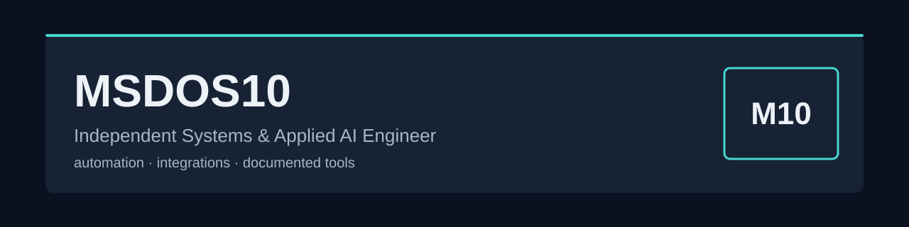
    </picture>
  </a>

  <a href="https://toskaman.github.io/"><strong>Portfolio</strong></a>
  &nbsp;·&nbsp; <a href="#partners">Partners</a>
  &nbsp;·&nbsp; <a href="#selected-work">Work</a>
  &nbsp;·&nbsp; <a href="#hackathons-2026">Hackathons</a>
  &nbsp;·&nbsp; <a href="#contact">Contact</a>

 

<h3 align="center">Hardware partners</h3>

  <a href="https://www.engoeyewear.com"><picture><source media="(prefers-color-scheme: dark)" srcset="assets/partner-engo-dark.svg" /><source media="(prefers-color-scheme: light)" srcset="assets/partner-engo-light.svg" /></picture></a>
   
  <a href="https://heltec.cn/"><picture><source media="(prefers-color-scheme: dark)" srcset="assets/partner-heltec-dark.svg" /><source media="(prefers-color-scheme: light)" srcset="assets/partner-heltec-light.svg" /></picture></a>
   
  <a href="https://www.elecrow.com/"><picture><source media="(prefers-color-scheme: dark)" srcset="assets/partner-elecrow-dark.svg" /><source media="(prefers-color-scheme: light)" srcset="assets/partner-elecrow-light.svg" /></picture></a>
   
  <a href="https://www.airgradient.com/"><picture><source media="(prefers-color-scheme: dark)" srcset="assets/partner-airgradient-dark.svg" /><source media="(prefers-color-scheme: light)" srcset="assets/partner-airgradient-light.svg" /></picture></a>

  Building connected hardware? <a href="mailto:toskaman5962+portfolio@gmail.com?subject=Hardware%20partnership">Let's integrate it.</a>

 

<h3 align="center">Certification</h3>

  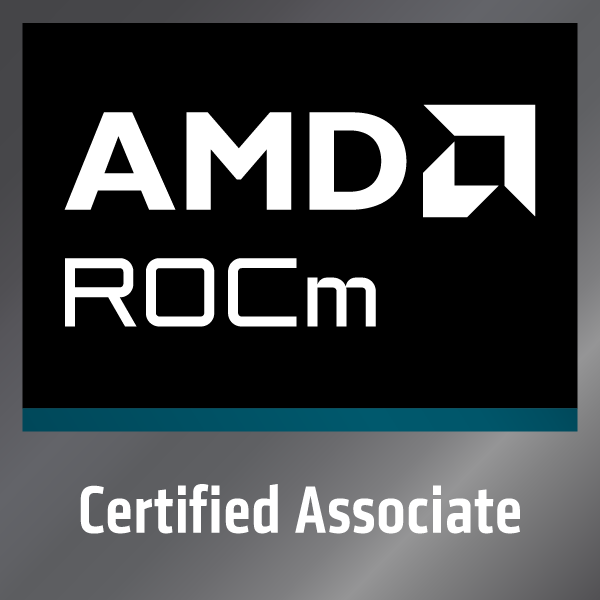
   
  <strong>AMD ROCm™ Certified Associate</strong> · November 2026

 

<picture>
  <source media="(prefers-color-scheme: dark)" srcset="assets/div-work-dark.svg" />
  <source media="(prefers-color-scheme: light)" srcset="assets/div-work-light.svg" />
  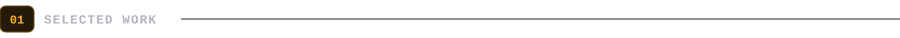
</picture>

  <a href="https://github.com/toskaman/openbridge"><picture><source media="(prefers-color-scheme: dark)" srcset="assets/card-openbridge-dark.svg" /><source media="(prefers-color-scheme: light)" srcset="assets/card-openbridge-light.svg" />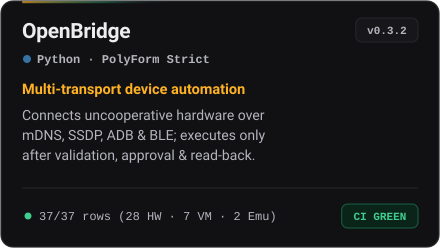</picture></a>
  <a href="https://github.com/toskaman/genesis-rt"><picture><source media="(prefers-color-scheme: dark)" srcset="assets/card-genesis-dark.svg" /><source media="(prefers-color-scheme: light)" srcset="assets/card-genesis-light.svg" /></picture></a>
   
  <a href="https://github.com/toskaman/anticipate-codegeist-2026"><picture><source media="(prefers-color-scheme: dark)" srcset="assets/card-anticipate-dark.svg" /><source media="(prefers-color-scheme: light)" srcset="assets/card-anticipate-light.svg" /></picture></a>
  <a href="https://github.com/toskaman/OpenKF"><picture><source media="(prefers-color-scheme: dark)" srcset="assets/card-openkf-dark.svg" /><source media="(prefers-color-scheme: light)" srcset="assets/card-openkf-light.svg" />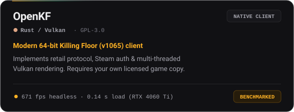</picture></a>

  <strong>OpenBridge:</strong> <a href="https://github.com/toskaman/openbridge/blob/main/docs/DEVICE_EVIDENCE.json">Evidence</a> · <a href="https://youtu.be/TZaxCcRmrLQ">Demo</a>
  &nbsp;|&nbsp;
  <strong>GENESIS RT:</strong> <a href="https://github.com/toskaman/genesis-rt/blob/main/docs/CLAIMS.md">Claims</a>
  &nbsp;|&nbsp;
  <strong>Anticipate:</strong> <a href="https://github.com/toskaman/anticipate-codegeist-2026/blob/main/docs/evidence/EVIDENCE_PACK.md">Evidence Pack</a> · <a href="https://youtu.be/kNBhV1Di82U">Demo</a>
  &nbsp;|&nbsp;
  <strong>OpenKF:</strong> <a href="https://github.com/toskaman/OpenKF/blob/main/docs/BENCHMARKS.md">Benchmarks &amp; Limits</a>

 

<picture>
  <source media="(prefers-color-scheme: dark)" srcset="assets/div-hackathons-dark.svg" />
  <source media="(prefers-color-scheme: light)" srcset="assets/div-hackathons-light.svg" />
  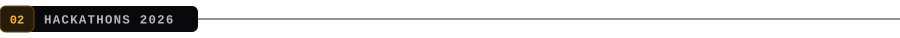
</picture>

  <picture>
    <source media="(prefers-color-scheme: dark)" srcset="assets/hackathons-banner-dark.svg" />
    <source media="(prefers-color-scheme: light)" srcset="assets/hackathons-banner-light.svg" />
    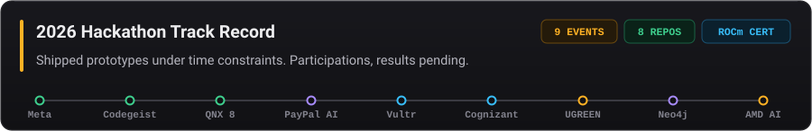
  </picture>

| Hackathon | Organizer | Entry | Status |
|---|---|---|---|
| [**Meta AI Devices**](https://cerebralvalley.ai/e/meta-ai-developer-hackathon/details) | Meta | [**OpenBridge**](https://github.com/toskaman/openbridge) · device automation fabric | Submitted |
| [**Codegeist 2026**](https://codegeist2026.devpost.com/) | Atlassian | [**Anticipate**](https://github.com/toskaman/anticipate-codegeist-2026) · Jira decision firewall | Results 15 Feb 2027 |
| [**QNX Global Hackathon**](https://qnx.devpost.com/) | BlackBerry QNX | [**GENESIS RT**](https://github.com/toskaman/genesis-rt) · QNX-native machine software | Results 4 Feb 2027 |
| [**PayPal AI Hackathon**](https://paypalaihackathon.devpost.com/) | PayPal | [**AFTERPACT**](https://github.com/toskaman/afterpact) · agentic commerce assurance | Results 21 Dec 2026 |
| [**Vultr: Agent Rush**](https://lablab.build/ai-hackathons/vultr-hackathon) | Vultr × lablab | [**REVERSA**](https://github.com/toskaman/reversa) · self-healing AI operations | Submitted |
| [**Open Agentic Web**](https://cognizant-agenticweb.devpost.com/) | Cognizant AI Lab | [**CONTINUITY**](https://github.com/toskaman/continuity-agentic-web) · multi-provider change coordinator | Results 19 Jan 2027 |
| [**UGREEN AI NAS**](https://ugreenhackathon.devpost.com/) | UGREEN | [**PHOENIX**](https://github.com/toskaman/UGREEN-PHOENIX) · NAS recovery checks | Results 6 Dec 2026 |
| [**Buffer Commit**](https://buffer.com/api/commit) | Buffer | [**CAMPAIGN HOTFIX**](https://campaign-hotfix.onrender.com) · change control for scheduled campaigns | Results 7 Dec 2026 |
| [**Relate by Neo4j**](https://relate.devpost.com/) | Neo4j | [**UNLOCK**](https://github.com/toskaman/unlock-accessibility-graph) · accessibility impact graph | Results 18 Dec 2026 |
| [**Heads Up**](https://dorahacks.io/hackathon/even-realities/detail) | Even Realities | **PARALLAX** · app for Even G2 smart glasses | In progress · deadline 29 Nov |
| [**AMD AI League**](https://lablab.build/ai-hackathons/amd-lablab-ai-academy-challenge) | AMD × lablab | Participant · AMD ROCm™ Certified Associate | Certified |

 

<picture>
  <source media="(prefers-color-scheme: dark)" srcset="assets/div-more-dark.svg" />
  <source media="(prefers-color-scheme: light)" srcset="assets/div-more-light.svg" />
  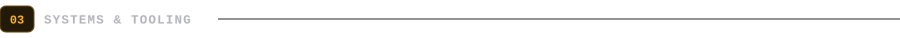
</picture>

  <a href="https://github.com/toskaman/orpane-proof-package"><picture><source media="(prefers-color-scheme: dark)" srcset="assets/mini-orpane-dark.svg" /><source media="(prefers-color-scheme: light)" srcset="assets/mini-orpane-light.svg" />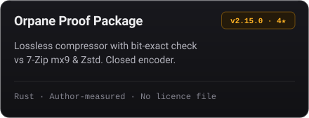</picture></a>
  <a href="https://github.com/toskaman/reversa"><picture><source media="(prefers-color-scheme: dark)" srcset="assets/mini-reversa-dark.svg" /><source media="(prefers-color-scheme: light)" srcset="assets/mini-reversa-light.svg" />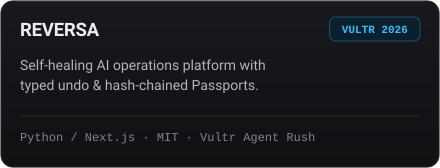</picture></a>
   
  <a href="https://github.com/toskaman/afterpact"><picture><source media="(prefers-color-scheme: dark)" srcset="assets/mini-afterpact-dark.svg" /><source media="(prefers-color-scheme: light)" srcset="assets/mini-afterpact-light.svg" />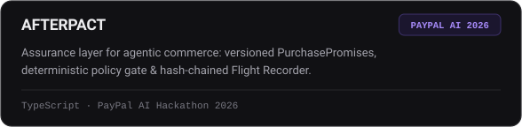</picture></a>
  <a href="https://github.com/toskaman/Freenekit"><picture><source media="(prefers-color-scheme: dark)" srcset="assets/mini-freenekit-dark.svg" /><source media="(prefers-color-scheme: light)" srcset="assets/mini-freenekit-light.svg" />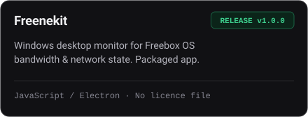</picture></a>

 

  <a href="mailto:toskaman5962+portfolio@gmail.com">
    <picture>
      <source media="(prefers-color-scheme: dark)" srcset="assets/footer-dark.svg" />
      <source media="(prefers-color-scheme: light)" srcset="assets/footer-light.svg" />
      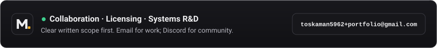
    </picture>
  </a>

  
  
  

Licensing &amp; rights disclosure

- **OpenBridge** — PolyForm Strict 1.0.0 on current main. That licence limits use.
- **Anticipate** — proprietary, shared 50/50 with Orphee. A deal needs both holders. Write to `info@lepcpro.fr`.
- **GENESIS RT** — Apache-2.0.
- **REVERSA** — MIT.
- **OpenKF** — GPL-3.0-or-later. The clean-room statement is the author's. Any acquisition needs an IP review, and the game itself is not mine to license.
- **Orpane, Freenekit, BridgeWindows, RBX-Manager-2** — no licence file. Evaluation only, in writing.

Nothing on this page is an offer to sell a right that is shared, missing, or someone else's.

